<picture>
  <source media="(prefers-color-scheme: dark)" srcset="frontend/assets/readme/hero-dark.png">
  <source media="(prefers-color-scheme: light)" srcset="frontend/assets/readme/hero-light.png">
  
</picture>

<p align="center">
  AI reads utility bills into an audited greenhouse gas inventory.<br>
  Hedera certifies it, and carbon credits are bought and retired on chain, with a public proof for every step.
</p>

<p align="center">
  <a href="https://greentrace-app.vercel.app"></a>
  <a href="https://youtu.be/xWBNFqHfmGY"></a>
  <a href="https://greentrace-app.vercel.app/certificates/GT-2026-Q5LL89"></a>
  <a href="https://hashscan.io/testnet/topic/0.0.11116480"></a>
</p>

<p align="center">
  <a href="https://ieee-climatechain-hack.devpost.com/"></a>
  
  <a href="https://hashscan.io/testnet/topic/0.0.11116480"></a>
  
  
  
  
  
  
</p>

<p align="center">
  <a href="#-demo-video">Demo</a> ·
  <a href="#-why-we-chose-hedera">Why Hedera</a> ·
  <a href="#-what-it-does">Features</a> ·
  <a href="#-track-1-alignment">Track 1</a> ·
  <a href="#-ai-that-you-can-audit">AI</a> ·
  <a href="#%EF%B8%8F-hedera-integration">Hedera</a> ·
  <a href="#%EF%B8%8F-screenshots">Screenshots</a> ·
  <a href="#-quick-start">Quick start</a> ·
  <a href="#%EF%B8%8F-architecture">Architecture</a> ·
  <a href="#-ieee-climatechain-deliverables">Deliverables</a>
</p>

<p align="center">
  Built for the <b>IEEE ClimateChain Global Hackathon 2026</b>, <b>Track 1: Carbon Markets & Emissions Transparency</b>,<br>
  organized by the <a href="https://cmte.ieee.org/turkiye-blockchain/hackatlon/">IEEE Blockchain Türkiye Group</a> with the IEEE Blockchain Technical Committee and IEEE chapters in support of UN COP 31.
</p>

<br>

<table align="center">
  <tr>
    <td align="center" width="25%">🤖<br><b>6 AI features</b><br><sub>every number computed by code</sub></td>
    <td align="center" width="25%">🔍<br><b>9 audit rules</b><br><sub>before any certificate is issued</sub></td>
    <td align="center" width="25%">✅<br><b>5 public checks</b><br><sub>re-run on every certificate view</sub></td>
    <td align="center" width="25%">🌍<br><b>14 grid factors</b><br><sub>official, picked by the site's country</sub></td>
  </tr>
</table>

## 🎬 Demo video

<p align="center">
  <a href="https://youtu.be/xWBNFqHfmGY">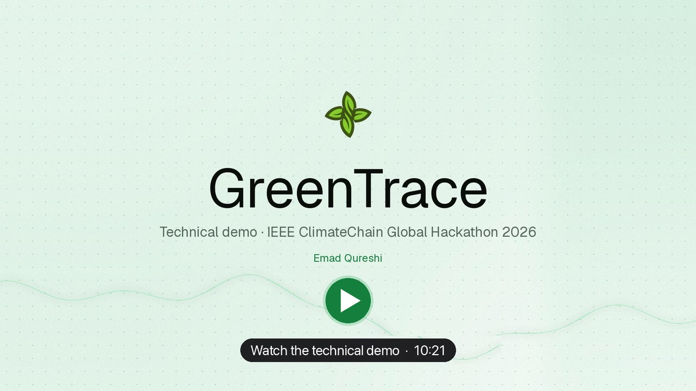</a>
</p>

<details>
<summary><b>Chapters</b></summary>
<br>

| | | | |
| --- | --- | --- | --- |
| [0:00](https://youtu.be/xWBNFqHfmGY?t=0) Intro | [0:38](https://youtu.be/xWBNFqHfmGY?t=38) Why Hedera | [1:48](https://youtu.be/xWBNFqHfmGY?t=108) AI bill reading | [2:29](https://youtu.be/xWBNFqHfmGY?t=149) Spreadsheet import |
| [3:02](https://youtu.be/xWBNFqHfmGY?t=182) GHG calculator | [3:27](https://youtu.be/xWBNFqHfmGY?t=207) AI and rule audit | [3:42](https://youtu.be/xWBNFqHfmGY?t=222) Certificate NFT | [3:59](https://youtu.be/xWBNFqHfmGY?t=239) Marketplace |
| [4:40](https://youtu.be/xWBNFqHfmGY?t=280) Buying credits | [5:01](https://youtu.be/xWBNFqHfmGY?t=301) Retiring credits | [5:54](https://youtu.be/xWBNFqHfmGY?t=354) Reduction plan | [6:12](https://youtu.be/xWBNFqHfmGY?t=372) SEMA |
| [7:41](https://youtu.be/xWBNFqHfmGY?t=461) Materiality matrix | [8:09](https://youtu.be/xWBNFqHfmGY?t=489) Report on Hedera | [8:55](https://youtu.be/xWBNFqHfmGY?t=535) Audit trail | [9:43](https://youtu.be/xWBNFqHfmGY?t=583) Climate impact |

</details>

## 🌿 Why we chose Hedera

A carbon accounting platform is only as trustworthy as the ledger underneath it, and that ledger should not add to the problem it measures.
We compared the options against what GreenTrace actually needs: a cheap, ordered, permanent record of every step, native carbon tokens that can be destroyed on retirement, and wallets people already use.
Hedera meets all of them out of the box.

| Reason | Why it matters for GreenTrace |
| --- | --- |
| 🌱 **Low energy, carbon negative** | In UCL's 2021 study of proof-of-stake networks, Hedera had the lowest energy use of the networks compared, and Hedera offsets its own footprint. A climate tool should not run on a ledger that adds emissions. |
| 🧾 **Consensus Service built for audit trails** | Every bill reading, audit, certificate, purchase, retirement and SEMA step is written to one [HCS topic](https://hashscan.io/testnet/topic/0.0.11116480) with a consensus timestamp and a fixed order. Records cannot be edited or deleted, which is what makes the trail compliance-ready. |
| 💲 **Fixed fees of a fraction of a cent** | Fees are priced in US dollars (paid in HBAR), not bid in a gas auction, so cost is predictable. Logging a finalized SEMA report cost **$0.00024**, so we can anchor every step, not just the final certificate. |
| 🪙 **Native tokens with retirement built in** | CO2e credits are a Hedera Token Service token and certificates are HTS NFTs. Retiring credits uses the token's wipe key, which removes them from the total supply, so a tonne can never be sold or claimed twice. No custom token contract to audit. |
| ⚡ **Final in seconds** | Hashgraph consensus is final in a few seconds with no forks or reorganizations, so a purchase can be verified and delivered while the buyer is still on the page. |
| 🦊 **EVM and a public mirror node** | Buyers pay and sign with MetaMask through a Solidity contract, and the server checks every payment and retirement on the mirror node before it delivers or burns anything. |

## 🔗 Links

<table>
  <tr>
    <th align="left" width="33%">🌐 Try it</th>
    <th align="left" width="33%">⛓️ On Hedera testnet</th>
    <th align="left" width="34%">📚 Project</th>
  </tr>
  <tr valign="top">
    <td>
      <a href="https://greentrace-app.vercel.app">Live app</a><br>
      <a href="https://greentrace-app.vercel.app/certificates/GT-2026-Q5LL89">Verify a certificate</a> (no account)<br>
      <a href="https://greentrace-app.vercel.app/marketplace">Carbon credit marketplace</a><br>
      <a href="https://greentrace-app.vercel.app/api/health">Service health</a>
    </td>
    <td>
      <a href="https://hashscan.io/testnet/topic/0.0.11116480">Audit trail (HCS) <code>0.0.11116480</code></a><br>
      <a href="https://hashscan.io/testnet/token/0.0.11116482">CO2e credit token <code>0.0.11116482</code></a><br>
      <a href="https://hashscan.io/testnet/token/0.0.11116483">Certificate NFTs <code>0.0.11116483</code></a><br>
      <a href="https://hashscan.io/testnet/contract/0.0.11116506">Exchange contract <code>0.0.11116506</code></a>
    </td>
    <td>
      <a href="https://youtu.be/xWBNFqHfmGY">Demo video</a><br>
      <a href="https://ieee-climatechain-hack.devpost.com/">Hackathon on Devpost</a><br>
      <a href="#-ieee-climatechain-deliverables">Deliverable documents</a><br>
      <a href="https://greentrace-app.vercel.app/privacy">Privacy</a> · <a href="https://greentrace-app.vercel.app/terms">Terms</a>
    </td>
  </tr>
</table>

## 🌱 What it does

<table>
  <tr valign="top">
    <td width="50%">
      <h4>📄 AI bill reading</h4>
      Drop in PDFs or photos of bills. The AI transcribes quantities with the exact evidence text and a confidence score; emissions come from an official factor catalog, never from the model.
    </td>
    <td width="50%">
      <h4>🔍 Pre-certification audit</h4>
      Nine deterministic checks plus an AI reviewer catch double-counted bills, overlapping periods, unit slips and implausible values. A high-risk inventory cannot be certified.
    </td>
  </tr>
  <tr valign="top">
    <td>
      <h4>🏅 Verifiable certificates</h4>
      The inventory is hashed, its metadata pinned to IPFS, a certificate NFT minted and the record written to Hedera Consensus Service. Anyone can verify it from a public page.
    </td>
    <td>
      <h4>🛒 Carbon credit marketplace</h4>
      AI quality ratings for every project, an AI offset advisor that builds a basket for your remaining emissions, and purchases paid in HBAR through a smart contract.
    </td>
  </tr>
  <tr valign="top">
    <td>
      <h4>🔥 On-chain retirement</h4>
      Retiring credits wipes the tokens from your account and from supply, so a tonne can never be sold or claimed twice.
    </td>
    <td>
      <h4>📉 AI reduction planner</h4>
      A costed plan with tonnes computed from your own inventory and a trajectory to your target year, anchored so progress can be checked.
    </td>
  </tr>
  <tr valign="top">
    <td>
      <h4>🤝 SEMA and GRI reporting</h4>
      Stakeholder engagement and materiality assessment with every step logged on Hedera, and AI-drafted GRI disclosures that mark missing facts instead of inventing them.
    </td>
    <td>
      <h4>🧮 GHG calculator and imports</h4>
      A GHG Protocol calculator for what bills miss (refrigerant leaks, fuels), and spreadsheet import that maps columns and activities by itself.
    </td>
  </tr>
</table>

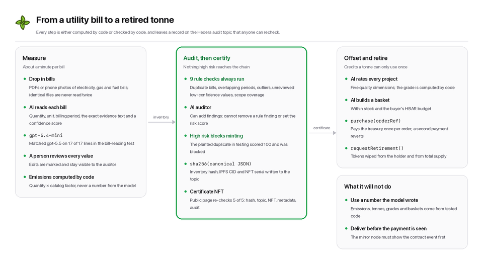

## 🎯 Track 1 alignment

| Track 1 asks for | GreenTrace |
| --- | --- |
| Real-time emissions tracking | AI reads bills into a Scope 1 and 2 inventory in seconds; every reading is anchored on Hedera |
| Blockchain-based carbon credit verification | Certificates are NFTs whose inventory hash, metadata and consensus record anyone can recheck |
| Smart contracts to prevent double counting | Duplicate bills are blocked before certification, each payment settles one order on chain, and retirement wipes tokens from supply |
| Transparent carbon trading platforms | HBAR purchases through `GreenTraceExchange`, AI-rated projects, and every trade on the public audit topic |


## 🤖 AI that you can audit


| Feature | The model does | Code guarantees | Anchored on Hedera |
| --- | --- | --- | --- |
| Bill reading | Transcribes quantity, unit, period and evidence; reads the site country; picks a source from a fixed catalog | Unit conversion, emission factors (official national grid factors for 14 regions), duplicate-bill fingerprinting, factor-to-country check | `AI_EXTRACTION` |
| Pre-certification audit | Reviews plausibility, misclassification and evidence | Nine rules always run; risk score computed from all findings | `AI_AUDIT` |
| Credit quality rating | Scores additionality, permanence, MRV, leakage, co-benefits | Weighted score and grade | `AI_CREDIT_RATING` |
| Offset advisor | Proposes a diversified basket | Stock, need and budget enforced | - |
| Reduction planner | Proposes measures and the share of a source each removes | Tonnes, annualization, trajectory | `AI_REDUCTION_PLAN` |
| GRI drafter | Drafts GRI 2-29, 3-1, 3-2, 3-3, 305-1 and 305-2 | Missing facts marked `[DATA NEEDED]` | `AI_GRI_DRAFT` |

> [!NOTE]
> Outputs are schema-validated JSON, and every AI result is hashed with its model and prompt version and logged on chain.
> Bill reading runs on `gpt-5.4-mini` (as accurate as the larger model in [testing](frontend/docs/TESTING.md#ai-model-evaluation)), the judgement-heavy features on `gpt-5.5`; Claude is supported as a drop-in alternative.
> See [Responsible AI](frontend/docs/RESPONSIBLE-AI.md).

<p align="center">
  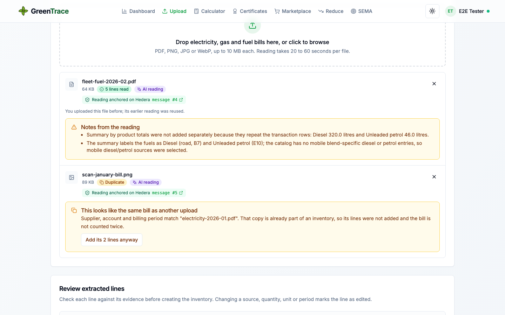
  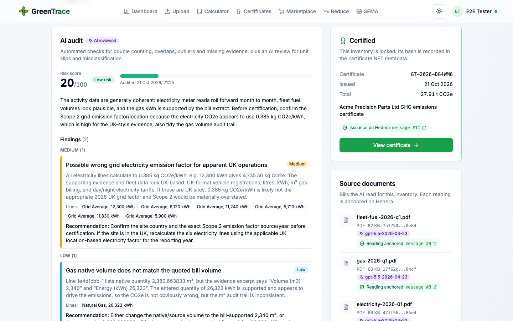
</p>

## ⛓️ Hedera integration

| Asset | ID | Purpose |
| --- | --- | --- |
| 🧾 Audit topic (HCS) | [`0.0.11116480`](https://hashscan.io/testnet/topic/0.0.11116480) | Ordered, timestamped, immutable record of every certificate, audit, AI result, purchase, retirement and SEMA step |
| 🌿 CO2e credit token (HTS) | [`0.0.11116482`](https://hashscan.io/testnet/token/0.0.11116482) | 1 token = 1 tonne CO2e; the wipe key retires credits from supply |
| 🏅 Certificate NFTs (HTS) | [`0.0.11116483`](https://hashscan.io/testnet/token/0.0.11116483) | One NFT per certificate, metadata on IPFS |
| 💱 GreenTraceExchange (EVM) | [`0.0.11116506`](https://hashscan.io/testnet/contract/0.0.11116506) | HBAR purchases (one payment per order) and retirement requests |
| 🏦 Treasury | [`0.0.11116474`](https://hashscan.io/testnet/account/0.0.11116474) | Mints, delivers and retires; its key is held only on the server |

**Example:** certificate [`GT-2026-DG4WM6`](https://hashscan.io/testnet/token/0.0.11116483/1), 27.91 t CO2e, fully offset by 28 retired credits.

Why these services, and not another chain: see [Why we chose Hedera](#-why-we-chose-hedera).

## 🖼️ Screenshots

<p align="center">
  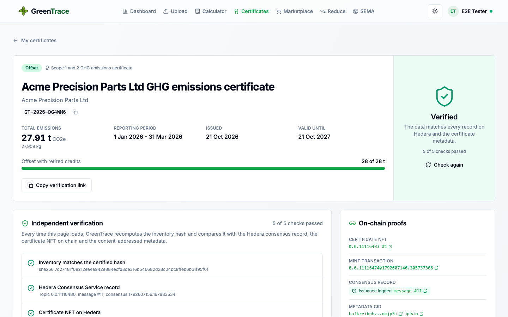
</p>

| | |
| --- | --- |
| 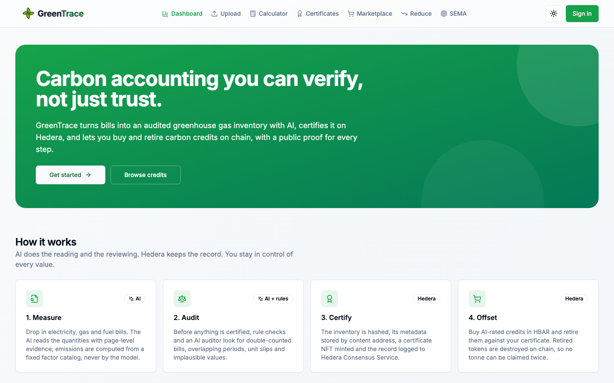 | 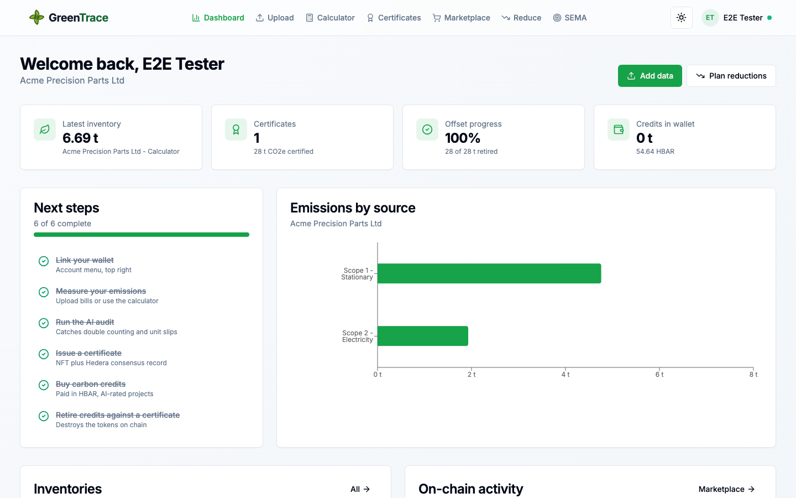 |
| 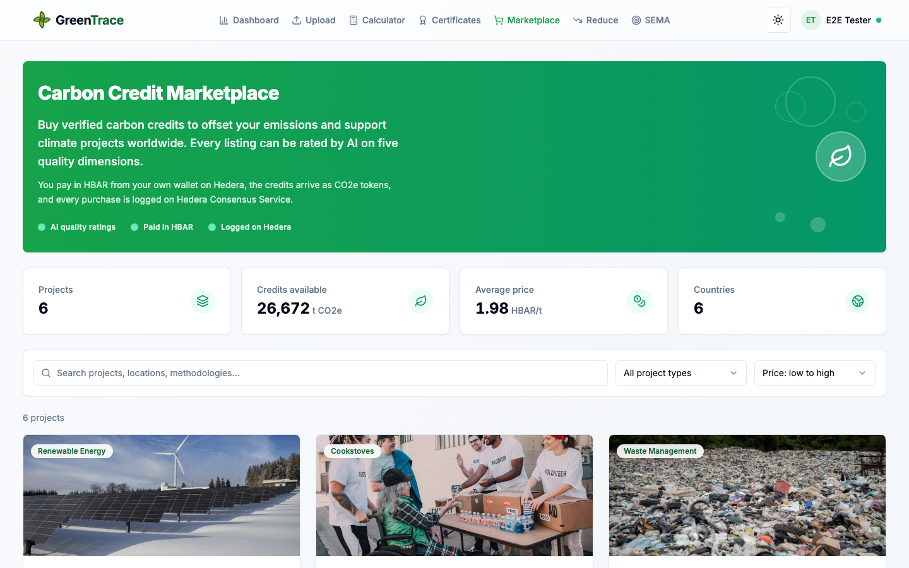 | 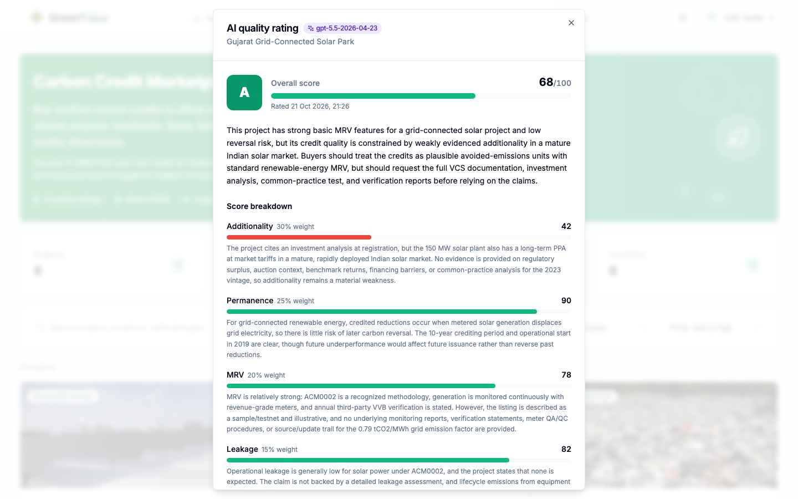 |
| 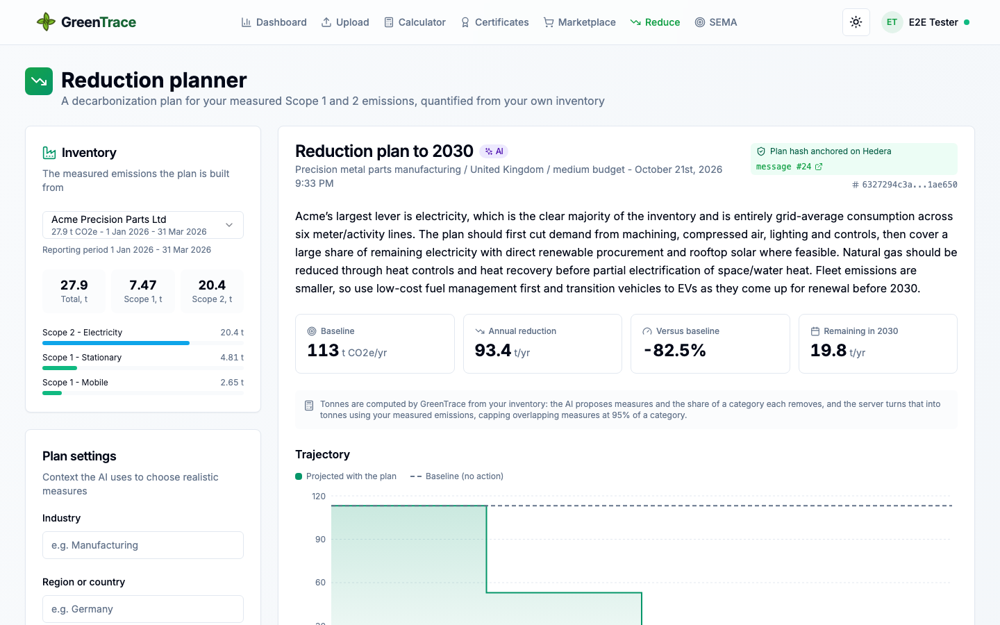 | 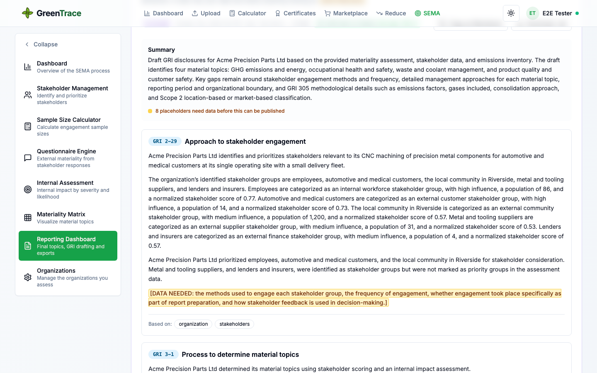 |

## 🚀 Quick start

> [!TIP]
> **Trying it as a judge?** No setup needed.
> Open [greentrace-app.vercel.app](https://greentrace-app.vercel.app), sign up with email or Google, link MetaMask from the account menu and press **Get 25 test HBAR**.
> The treasury funds your wallet once, so you can buy and retire credits on testnet without the public faucet.

<details>
<summary><b>Run it locally</b></summary>
<br>

**Prerequisites**

- Node.js 20+ and `psql`
- A Supabase project
- A Hedera testnet account with HBAR ([faucet](https://portal.hedera.com/faucet))
- An OpenAI or Anthropic API key (optional: without one the rule-based audit still runs)
- A Pinata JWT (optional: without it metadata is content-addressed and served by the app)

**Install and run**

```bash
cd frontend
npm install
cp .env.example .env.local      # fill in Supabase, HEDERA_OPERATOR_KEY and an AI key
npm run db:migrate              # create the schema with row level security
npm run setup:hedera            # create the topic, tokens and contract; writes their ids to .env.local
npm run seed                    # sample marketplace listings
npm run dev                     # http://localhost:3000
```

**Completing payments when the tab closes**

```bash
psql "$SUPABASE_DB_URL" -v app_url=https://your-app.vercel.app -f supabase/schedule-scan.sql
```

Supabase's pg_cron then calls `/api/internal/scan` every minute, which reads new exchange events from the mirror node and completes any purchase or retirement the browser did not report.
For completion within seconds, the optional [`backend-listener/`](backend-listener) service does the same continuously.

</details>

## 🏗️ Architecture


<details>
<summary><b>Sequence: certifying an inventory</b></summary>
<br/>

</details>

<details>
<summary><b>Sequence: buying and retiring credits</b></summary>
<br/>

</details>

<details>
<summary><b>Server components, data model and trust boundaries</b></summary>
<br/>
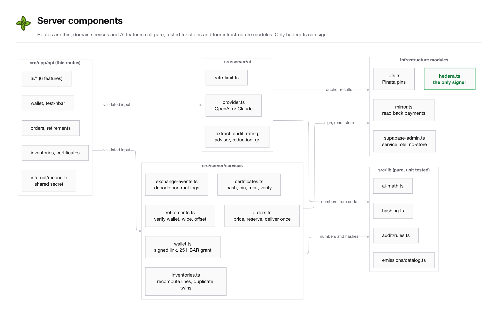


</details>

Full specification: [docs/ARCHITECTURE.md](frontend/docs/ARCHITECTURE.md).
Diagram sources live in [docs/diagrams](frontend/docs/diagrams) (`node scripts/render-diagrams.mjs`) and [tools/make_readme_art.py](frontend/tools/make_readme_art.py).

## 🌍 Climate impact

| | |
| --- | --- |
| 📏 **Accurate measurement** | AI removes manual transcription, the audit catches the errors that inflate or hide emissions, and electricity uses the official national grid factor for the bill's country (13 countries plus the EU-27 average, each from the publisher's own document, listed in [`src/data/gridFactors.ts`](frontend/src/data/gridFactors.ts)) |
| ✅ **Integrity of offsets** | Quality ratings steer buyers to better credits, and retirement destroys tokens so nothing is double counted |
| 📉 **Real reductions** | Plans quantified from measured data, anchored so progress can be checked against the next certified inventory |

Projections and methodology: [docs/CLIMATE-IMPACT.md](frontend/docs/CLIMATE-IMPACT.md).

## 🏆 IEEE ClimateChain deliverables

| Deliverable | Document |
| --- | --- |
| 🧩 Problem statement and solution overview | [docs/PROBLEM-AND-SOLUTION.md](frontend/docs/PROBLEM-AND-SOLUTION.md) |
| 🏗️ Architecture diagram and technical specification | [docs/ARCHITECTURE.md](frontend/docs/ARCHITECTURE.md) |
| 🔐 Security and data integrity assessment | [docs/SECURITY.md](frontend/docs/SECURITY.md) |
| 🌍 Climate impact assessment and reduction projections | [docs/CLIMATE-IMPACT.md](frontend/docs/CLIMATE-IMPACT.md) |
| 🚀 Implementation, adoption and scalability roadmap | [docs/ADOPTION-AND-ROADMAP.md](frontend/docs/ADOPTION-AND-ROADMAP.md) |
| 🧪 User testing results | [docs/TESTING.md](frontend/docs/TESTING.md) |
| 🤖 Responsible AI statement | [docs/RESPONSIBLE-AI.md](frontend/docs/RESPONSIBLE-AI.md) |
| 🎬 Technical demo video | [YouTube, 10:21](https://youtu.be/xWBNFqHfmGY) |

## 🛠️ Development

```bash
cd frontend
npm test                 # unit tests: units, catalog, audit rules, AI arithmetic, hashing, links
npm run test:contracts   # GreenTraceExchange
npm run test:db          # schema and row level security against a throwaway Postgres
npm run typecheck && npm run lint
```

| Layer | Technology |
| --- | --- |
| App | Next.js 14, React 18, TypeScript, Tailwind CSS, Radix UI, TanStack Query, Recharts |
| Data | Supabase (Postgres with row level security, Auth, Storage, pg_cron) |
| Ledger | Hedera Consensus Service, Token Service, EVM, mirror node; `@hashgraph/sdk`, ethers v6 |
| Contracts | Solidity 0.8.24, Hardhat |
| AI | OpenAI or Anthropic SDK with schema-validated structured outputs |
| Storage | IPFS via Pinata |

All settings live in `frontend/.env.local`; [`frontend/.env.example`](frontend/.env.example) documents each one.
No secret is ever exposed to the browser: `NEXT_PUBLIC_` variables hold public identifiers only.

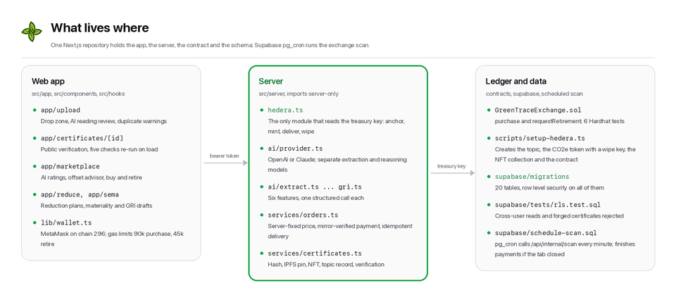

<details>
<summary><b>Annotated file tree</b></summary>
<br>
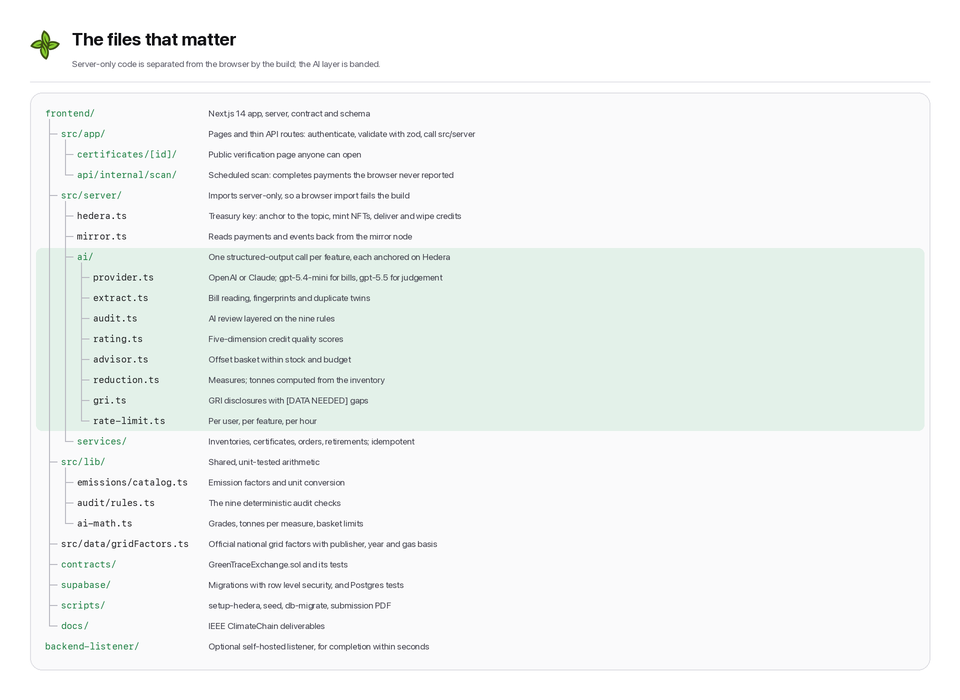
</details>

## 🔐 Security

Treasury signing happens only on the server; row level security keeps inventories private and makes certificates, ratings and retirements a public registry; payments and retirements are verified on the mirror node before anything moves.
Details: [docs/SECURITY.md](frontend/docs/SECURITY.md).

---

<p align="center">
  <br>
  <b>GreenTrace</b> · carbon accounting you can verify, not just trust<br>
  Built by <a href="https://github.com/EmadQureshiKhi">Emad Qureshi</a> · <a href="LICENSE">MIT License</a>
</p>
