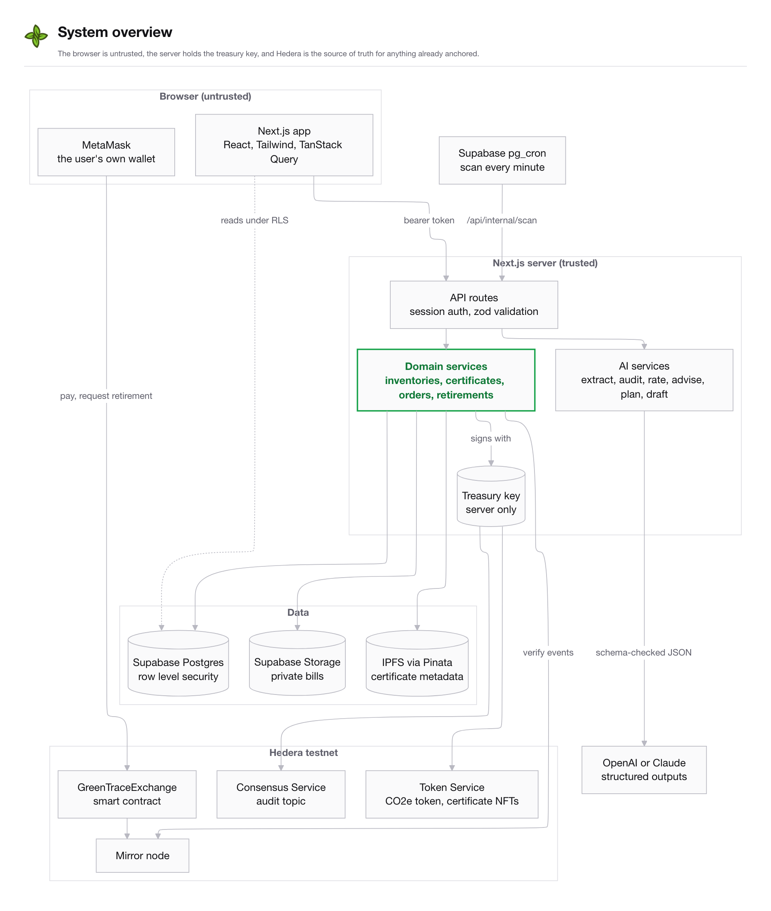
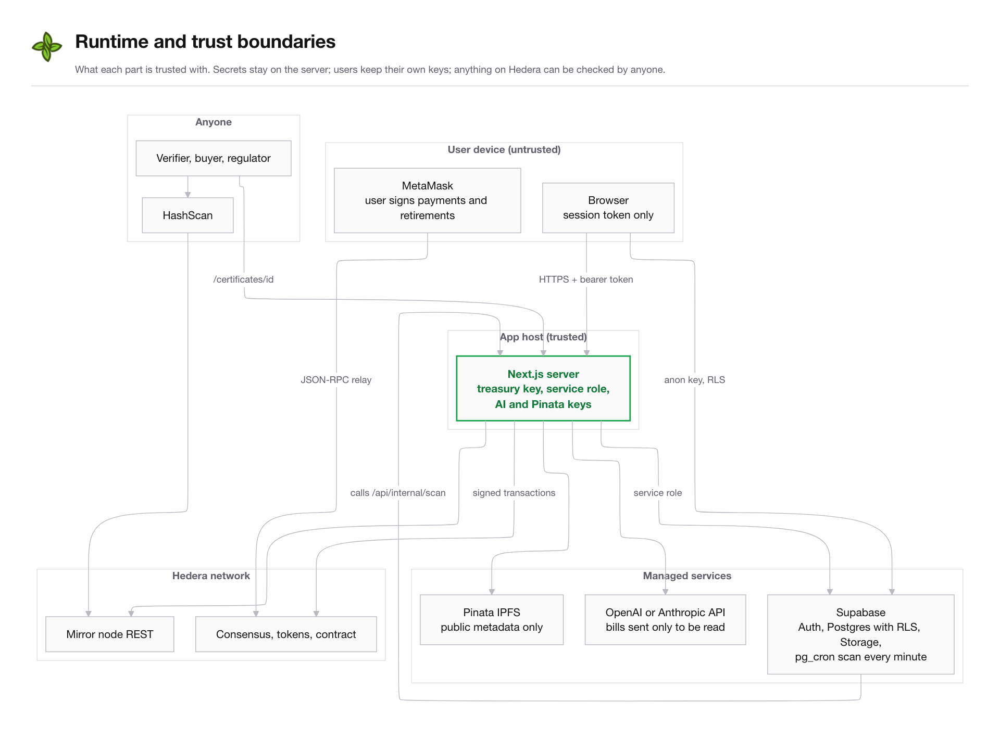
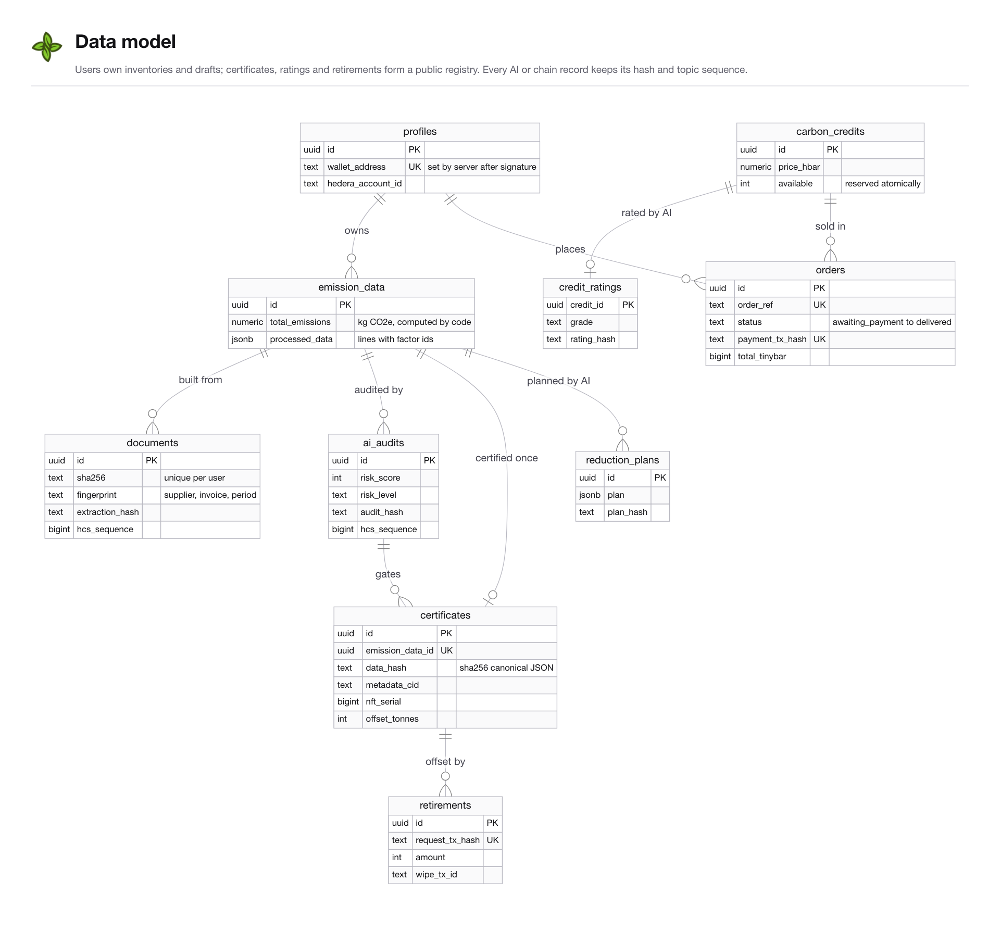
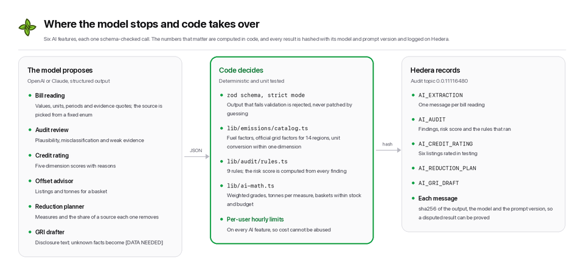
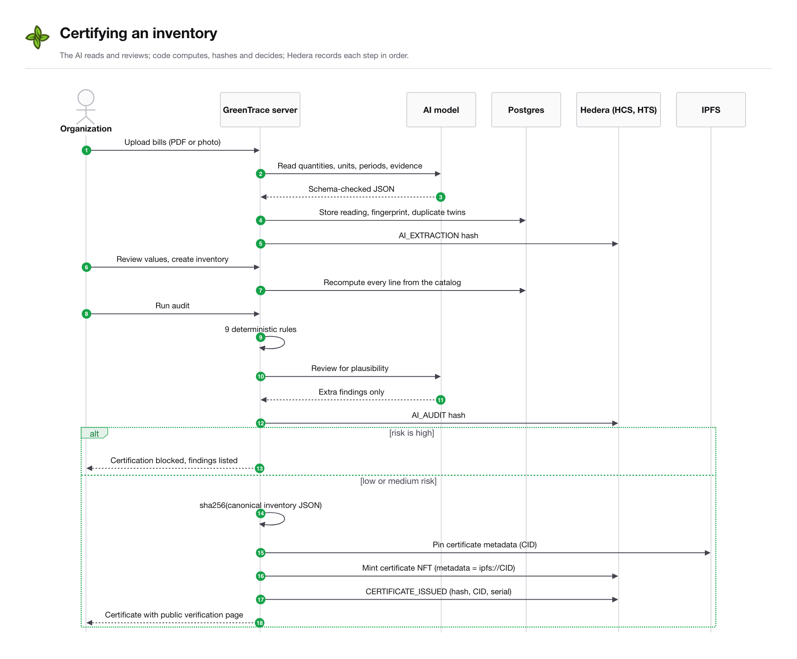
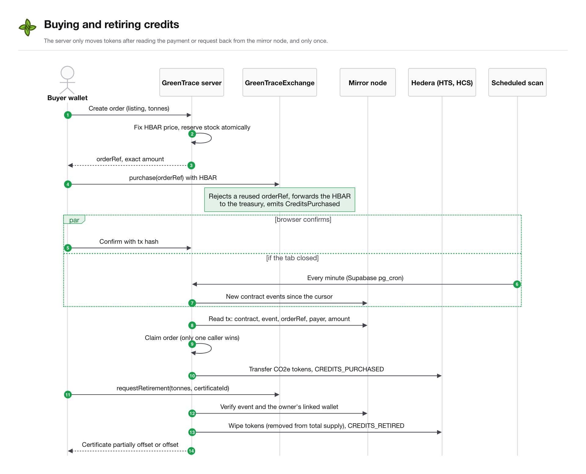
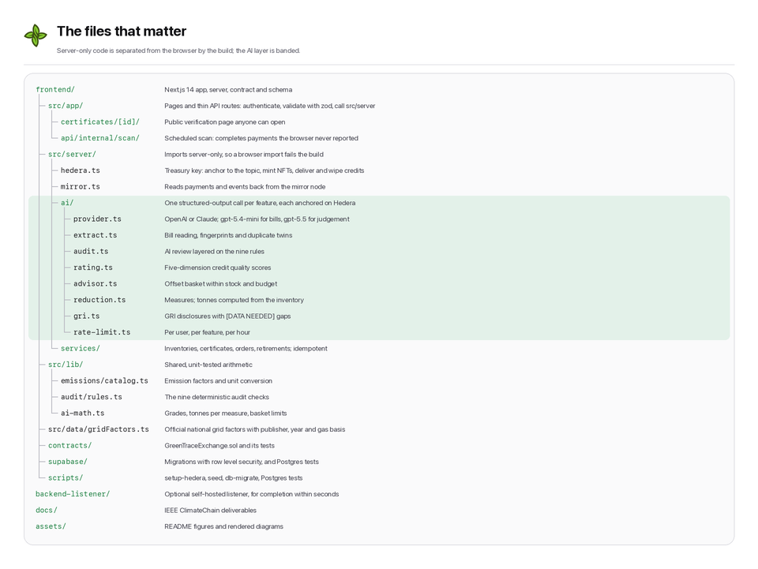

# GreenTrace architecture and technical specification

GreenTrace was built for the IEEE ClimateChain Global Hackathon 2026, Track 1: Carbon Markets & Emissions Transparency.
This document describes how the system is put together and why.

## System overview

The trust boundaries behind this picture (what each part is trusted with):

## Components

### Web app (frontend/)

A Next.js 14 app router application.
The browser talks to Supabase directly for reads, protected by row level security, and to the app's own API routes for anything that changes on-chain state or calls an AI model.
Wallet interactions use MetaMask (any EIP-1193 wallet) on the Hedera EVM (chain 296 on testnet).

### Server routes (frontend/src/app/api, frontend/src/server)

All privileged work happens here:

- The Hedera treasury key is read only by `src/server/hedera.ts`, which imports `server-only`, so the build fails if any browser code tries to import it.
- Every request is authenticated with the user's Supabase access token, and every input is validated with zod.
- Writes to tables that mirror on-chain state (certificates, orders, retirements, audits, extractions, ratings) use the service role and are never writable by browser clients.

### Database (frontend/supabase/migrations)

Postgres on Supabase.
Users own their working data (inventories and SEMA assessments).
Certificates, credit ratings and retirements form a public registry that anyone can read.
Policies are tested against a real Postgres instance by `npm run test:db`.

### Hedera

| Asset | Purpose |
| --- | --- |
| Consensus Service topic | Ordered, timestamped log of every certificate, audit, AI extraction, AI rating, reduction plan, purchase and retirement. Only the treasury can submit. |
| CO2e fungible token | One token is one tonne of CO2e. The treasury holds the supply and keeps a wipe key, so a retired credit is removed from the holder and from total supply. |
| Certificate NFT collection | One NFT per certificate. Its metadata is the `ipfs://` URI of the certificate's content-addressed JSON. |
| GreenTraceExchange contract | `purchase(orderRef)` forwards HBAR to the treasury and emits `CreditsPurchased`; `requestRetirement(amount, certificateId)` emits `RetirementRequested` from the holder's own wallet. |

### AI services (frontend/src/server/ai)

Each feature is a single structured-output call.
The model returns JSON that must match a zod schema.
Arithmetic, totals, scores, grades and on-chain actions are always computed by code, never by the model.

| Feature | Model does | Code does |
| --- | --- | --- |
| Bill extraction | Reads quantities, units, periods and evidence from a PDF or image, reads the site country, and picks a source from a fixed catalog (enum) | Converts units, applies emission factors (including the official national grid factor for the site country), warns when a grid factor does not match the country, fingerprints bills to catch duplicates, anchors a hash of the reading on Hedera |
| Pre-mint audit | Reviews plausibility, misclassification and evidence on top of rule results | Nine deterministic rules (duplicate bills, overlapping periods, outliers, unreviewed low-confidence values and more), scoring and risk level, anchoring |
| Reduction planner | Proposes measures and the share of a category each removes | Clamps shares, computes tonnes from the inventory, annualizes, builds the trajectory, anchors the plan hash |
| Credit rater | Scores five quality dimensions with rationale | Weighted overall score, letter grade, anchoring |
| Offset advisor | Proposes a diversified basket | Enforces stock, need and budget |
| GRI drafter | Drafts GRI 2-29, 3-1, 3-2, 3-3 and 305 text from assessment data, marking missing facts | Stores the draft and its hash |

The provider is pluggable: OpenAI when `OPENAI_API_KEY` is set (the deployed configuration), or Claude when `ANTHROPIC_API_KEY` is set.
Bill reading, the high-volume task, runs on a smaller model (`gpt-5.4-mini`) that matched the larger model's accuracy in testing ([TESTING.md](TESTING.md#ai-model-evaluation)); the judgement-heavy features run on `gpt-5.5`.
Without either key the rule-based audit still runs, and AI features explain how to enable them.

### Scheduled exchange scan (Supabase pg_cron)

Supabase's pg_cron calls `/api/internal/scan` every minute (`supabase/schedule-scan.sql`).
Each run reads the `GreenTraceExchange` events after a stored cursor from the mirror node and completes the purchases and retirements behind them, so they finish even if the user closes the browser right after paying.
The cursor, a lease and the last run live in `exchange_scan_state`; a failed transaction keeps the cursor so the next run retries it, and a declined one is skipped.
The endpoint takes no input and only completes what the chain shows, so it needs no credentials; it spaces its own runs at least 15 seconds apart.
An optional self-hosted listener (`backend-listener/`) does the same continuously through `/api/internal/reconcile` for completion within seconds.

### Test HBAR for judges and testers

On testnet, a signed-in user with a linked wallet can claim 25 HBAR once from the treasury (`/api/wallet/test-hbar`).
Sending HBAR to a new MetaMask address also creates its Hedera account, so a judge can buy and retire credits within a minute of signing up.
The grant is claimed atomically per account and never takes the treasury below a 100 HBAR reserve.

## Key flows

### Certify an inventory

1. The user uploads bills; each one is read by the AI and the reading is anchored (`AI_EXTRACTION`).
2. The user reviews and corrects values and creates an inventory; the server recomputes every line from the catalog.
3. The audit runs rule checks and the AI review and is anchored (`AI_AUDIT`).
4. If the audit is current and not high risk, the server hashes the inventory, stores the metadata by CID, mints the NFT and anchors `CERTIFICATE_ISSUED`.
5. Anyone can open `/certificates/<id>`; the verification endpoint recomputes the hash and checks it against the topic message, the NFT and the metadata.

### Buy and retire credits

#### Buy

1. The server creates an order, fixes the price in HBAR and reserves stock atomically.
2. The buyer's wallet calls `purchase(orderRef)` with the exact HBAR amount; the contract forwards it to the treasury.
3. The server (from the browser, or the scheduled scan if the tab closed) reads the transaction from the mirror node, checks the event, the order reference, the payer and the amount, then transfers the CO2e tokens and anchors `CREDITS_PURCHASED`.
   Only the request that moves the order out of `awaiting_payment` delivers, so concurrent confirmations cannot double deliver.

#### Retire

1. The certificate owner's linked wallet calls `requestRetirement(tonnes, certificateId)`.
2. The server verifies the event and the wallet, checks the balance, wipes the tokens from the holder (they leave total supply), anchors `CREDITS_RETIRED` and updates the certificate's offset status atomically.

## Repository

Diagram sources: [`docs/diagrams/`](diagrams).

## Technology

| Layer | Choice |
| --- | --- |
| App | Next.js 14, React 18, TypeScript, Tailwind CSS, Radix UI, TanStack Query, Recharts |
| Data | Supabase (Postgres, Auth, Storage) |
| Ledger | Hedera Consensus Service, Hedera Token Service, Hedera EVM, mirror node REST API, `@hashgraph/sdk`, ethers v6 |
| Contracts | Solidity 0.8.24, Hardhat |
| AI | Anthropic SDK (Claude) or OpenAI SDK, structured outputs with zod schemas |
| Storage | IPFS via Pinata when configured; content-addressed CIDv1 otherwise |
| Tests | Vitest (unit), Hardhat (contract), Postgres (schema and RLS) |

## Commands

| Command | What it does |
| --- | --- |
| `npm run dev` | Run the app on port 3000 |
| `npm test` | Unit tests (units, catalog, audit rules, AI arithmetic, hashing) |
| `npm run test:contracts` | Contract tests |
| `npm run test:db` | Apply migrations to a throwaway Postgres and run the RLS tests |
| `npm run db:migrate` | Apply migrations to the Supabase database |
| `npm run setup:hedera` | Create the topic, tokens and contract on Hedera |
| `npm run seed` | Create the sample marketplace listings |
