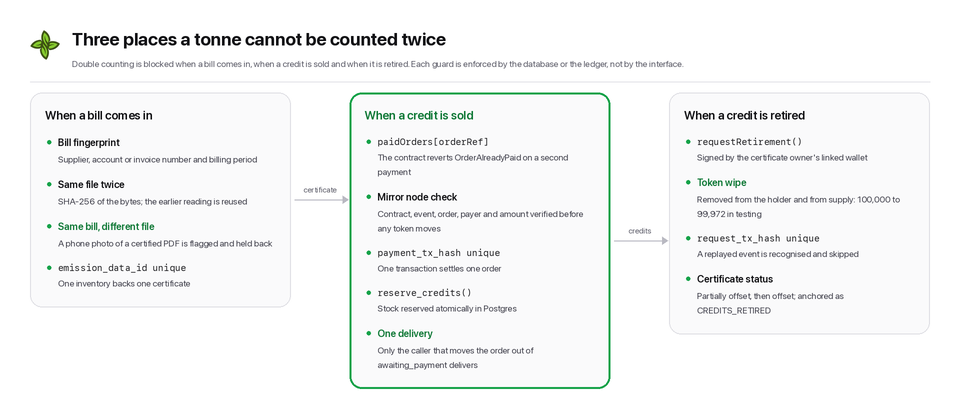

# Security and data integrity assessment

This assessment covers GreenTrace as submitted to the IEEE ClimateChain Global Hackathon 2026.
It explains what the system protects, how, what it does not protect yet, and what would change for a production deployment.

## Assets and trust boundaries

| Asset | Why it matters | Where it lives |
| --- | --- | --- |
| Treasury key | Mints certificates, delivers and retires credits, writes the audit log | Server environment only |
| Emission inventories | The basis of every certificate | Postgres, owned by the user |
| Certificates and retirements | Public claims buyers and regulators rely on | Postgres registry, Hedera topic, NFTs |
| Payments | Real value on mainnet | Hedera, via the exchange contract |
| Source documents | Commercially sensitive bills | Private storage bucket |
| AI outputs | Influence what gets certified | Postgres, hashed on Hedera |

The browser is untrusted.
The server is trusted with the treasury key.
Hedera is the source of truth for anything already anchored.

## Key management

- The treasury key is a server-only environment variable and is read in exactly one module, which imports `server-only` so any accidental browser import fails the build.
- No `NEXT_PUBLIC_` variable carries a secret; those hold public identifiers only (token, topic and contract ids).
- The topic's submit key is the treasury key, so nobody else can write GreenTrace audit records.
- Users sign their own payments and retirement requests in their own wallet; the server never holds user keys.
- Production would move the treasury key to a KMS or HSM and split duties (separate keys for minting, delivery and wiping, with an admin key held offline).

## Authentication and authorization

- Users authenticate with Supabase Auth (email and password, or Google).
- Every API route resolves the user from the bearer token on the server; there is no trust in client-supplied user ids.
- Row level security restricts each table: users read and write their own inventories and assessments, read their own orders, audits, extractions and plans, and can never write certificates, orders, retirements, audits or ratings.
- A trigger stops users from changing their own wallet linkage; only the server sets it after checking a signature.
- These rules are tested against a real Postgres instance (`npm run test:db`), including cross-user access attempts and forged certificate inserts.

## Wallet linking

- Linking requires a `personal_sign` signature over a message containing the user id, the wallet address and an issue time.
- The server recovers the signer, checks it matches the address, rejects messages older than ten minutes, and refuses a wallet already linked to another account.

## Data integrity

### Inventories

- The server recomputes every line from the emission factor catalog; client-supplied totals are ignored.
- Units are converted only within the same physical dimension, and incompatible units are rejected rather than guessed (for example kilograms of diesel against a per-litre factor).
- An inventory that backs a certificate becomes immutable, enforced in the database policy.

### Certificates

- The certificate's inventory is hashed with canonical JSON (sorted keys) and SHA-256.
- The hash, the metadata CID and the NFT serial are written to the Hedera topic.
- The NFT's on-chain metadata is the `ipfs://` URI of the metadata, which itself contains the inventory hash.
- The public verification endpoint recomputes the hash from the stored inventory and compares it against the topic message, the NFT and the metadata, so tampering with any one of them is detected.

### Double counting

- Bills are fingerprinted by supplier, account or invoice number and billing period; the same bill in two places is flagged as a high-risk audit finding before certification.
- Each inventory can back only one certificate (unique constraint).
- Each payment transaction can settle only one order, and each retirement request transaction can be processed only once (unique constraints plus status transitions that only one caller can win).
- Retirement wipes tokens from the holder's account and from total supply, so a retired tonne cannot be sold or retired again.

### Payments and retirements

- Order prices are fixed by the server, and stock is reserved atomically in the database.
- The server only delivers credits after reading the payment from the Hedera mirror node and checking the contract, the event, the order reference, the paying wallet and the amount.
- A retirement is processed only when the request came from the certificate owner's linked wallet and the wallet holds enough credits.
- A scheduled scan (Supabase pg_cron, every minute) guarantees completion when the browser closes early; processing is idempotent, so replays are harmless.
- The scan endpoint needs no credentials because it takes no input and can only complete transactions the mirror node shows; a database lease and a 15-second minimum interval stop it being run in parallel or flooded.

## AI-specific risks

| Risk | Mitigation |
| --- | --- |
| The model invents a value | Extraction must quote the evidence and page; values with low confidence must be reviewed; the audit flags unreviewed low-confidence values. |
| The model picks a wrong fuel or factor | It can only choose from an enum of catalog ids; factors come from code. |
| The model gets arithmetic wrong | No AI output feeds a number directly: emissions, tonnes, scores, grades and baskets are computed by code. |
| The model hides a problem | It can only add audit findings; it cannot remove the deterministic rule findings, and the risk score is computed from all findings. |
| Prompt injection in an uploaded document | Output is schema-constrained, never executed, never shown as HTML, and must pass server validation; a person reviews every line before it becomes an inventory. |
| AI output is later disputed | Each AI result is hashed with the model name and prompt version and anchored on Hedera. |
| Cost abuse | Per-user hourly limits per AI feature, and identical files are never re-read. |

## Privacy

- Source documents go to a private storage bucket readable only by their owner.
- Only hashes of documents and AI outputs go on chain; bill contents never do.
- SEMA records anchored on Hedera contain only an action name, a client id and a hash.
- Certificates are public by design (that is their purpose); inventories behind them are only exposed through the certificate verification page.

## Operational safeguards

- Server-side database reads bypass the framework's fetch cache, so verification and order state are always read live.
- The testnet HBAR grant is one per account, claimed with a conditional update so concurrent requests cannot both succeed, and it stops when the treasury reaches a fixed reserve.
- AI features are rate limited per user and per feature.
- Continuous integration (GitHub Actions) runs the type check, lint, unit, contract and row level security tests and a production build on every push, and checks every day that the live deployment's services are healthy and a certificate still verifies against Hedera.

## Known limitations

- Testnet only. The marketplace listings are sample projects and the CO2e token is issued by GreenTrace itself; a production system would mint tokens only against credits retired on a recognised registry (bridging) and attest to that on Hedera.
- The treasury is a single key held by the server (see key management above).
- Refunds for payments that arrive after an order expired and the listing sold out are flagged but handled manually.
- The audit's magnitude checks are heuristics; they reduce, not eliminate, the risk of a wrong inventory being certified.

## Verifying a deployment yourself

1. Open any certificate at `/certificates/<id>` and check that every verification item passes.
2. Follow the HashScan links to the topic message and the NFT, and compare the hash and CID.
3. Fetch `/api/ipfs/<cid>` and confirm the metadata contains the same inventory hash.
4. Run `npm test`, `npm run test:contracts` and `npm run test:db`.
